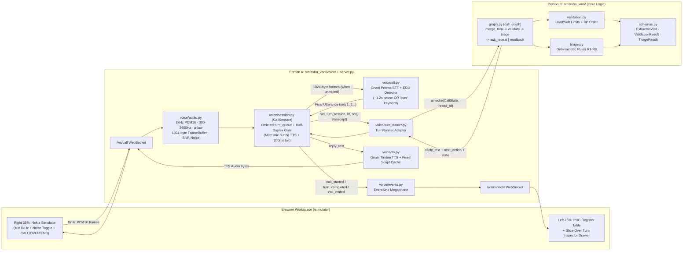

# ASHA-Vani: Agent & Teammate System Guide (`AGENTS.md` / `CLAUDE.md`)

This file is the single structural map for coding agents (Antigravity, Claude Code, Cursor) and both teammates working on **ASHA-Vani**. Read this before editing any file.

---

## 1. What ASHA-Vani Is (and Is Not)

- **What it is:** A voice-first decision-support & early-warning pipeline for rural Indian ASHA workers. The ASHA dials in from a basic feature phone (simulated Nokia in demo) and speaks Hindi/Hinglish. The system streams speech through **Gnani Prisma STT**, extracts structured register fields with an LLM (**Groq Llama 3.3 70B**, 8B fallback), runs a **deterministic clinical rule engine (R1–R8)**, speaks a digit-by-digit **confirm-back** via **Gnani Timbre TTS**, and pushes turn-by-turn structured updates to the **PHC Clinic Register Console**.
- **What it is NOT:** An autonomous doctor, a diagnosis engine, or an automatic ambulance dispatcher.
  - **The LLM extracts; deterministic code decides.** The model never assigns risk.
  - **Refuse to guess:** Hard-limit validation failures (`ERROR`) are cleared to `None` and routed to a repeat prompt—never stored.
  - **Alert early, commit late:** `CRITICAL` / `URGENT` cases appear marked `UNVERIFIED (In Call)` after Turn 1 and flip to `VERIFIED` only after the ASHA confirms readback.
  - **Label everything simulated:** All telephony, alerts, and referral actions carry a visible `SIM` badge.

---

## 2. Module Ownership & File Boundaries (Zero Merge Conflicts)

Do **not** edit the other person's files without coordinating first.

| Owner | Files / Directories | Responsibility |
|---|---|---|
| **Person B (Logic, Data & Graph)** | `src/asha_vani/schemas.py` `src/asha_vani/validation.py` `src/asha_vani/triage.py` `src/asha_vani/graph.py` `tests/test_validation.py` `tests/test_triage.py` `docs/person-b-build.md` | Shared Pydantic schemas, hard/soft range validation, deterministic rule engine (`R1–R8`), LangGraph conversation state machine (`call_graph`), LLM extraction node, and Supabase persistence. |
| **Person A (Voice, Session & Simulator)** | `src/asha_vani/voice/audio.py` `src/asha_vani/voice/events.py` `src/asha_vani/voice/turn_runner.py` `src/asha_vani/voice/stt.py` `src/asha_vani/voice/tts.py` `src/asha_vani/voice/session.py` `src/asha_vani/voice/simulator.html` `src/asha_vani/server.py` `tests/test_voice.py` `docs/person-a-build.md` | 8 kHz PCM16 / 300–3400 Hz / $\mu$-law / 1024-byte audio conditioning, Gnani Prisma STT & Timbre TTS clients, `CallSession` queues, half-duplex speaker muting, `"over"` + pause end-of-utterance detection, FastAPI WebSockets, and the 75/25 PHC Register + Nokia Simulator workspace. |
| **Shared / Root** | `AGENTS.md`, `README.md`, `pyproject.toml` | Project-wide rules, system connection map, and dependency manifest. |

---

## 3. System Connection Graph (How Every Node Connects)

---

## 4. Handoff Contracts & Known Integration Points

### 4.1 `TurnRunner` Bridge (`voice/turn_runner.py` ↔ `graph.py`)
- `CallSession` calls `await turn_runner.run_turn(session_id, utterance_seq, transcript) -> TurnOutput`.
- **Current status of `graph.py`:** `CallState` currently expects `extracted_turn: ExtractedVisit` (pre-extracted fixture) rather than extracting from `utterance: str`.
- **Three integration items tracked between Person A's `TurnRunner` and Person B's `graph.py`:**
  1. **LLM Extraction Node:** Until Person B adds the Groq extraction node into `graph.py`, `turn_runner.py` extracts `ExtractedVisit` + `PatientReference` from `transcript` and passes `extracted_turn` into `call_graph`.
  2. **Confirmation Step (`UNVERIFIED` → `VERIFIED`):** When the ASHA replies *"Haan sahi hai"* after a readback, the visit verification status transitions from `PENDING_CONFIRMATION` (`UNVERIFIED`) to `COMMITTED_VERIFIED` (`VERIFIED`).
  3. **Patient Identity (`PatientReference`):** Track `PatientReference` (`full_name`, `spouse_or_guardian_name`, `age_years`, `village`, `tola`) alongside `visit_values` so the PHC table row knows which patient the visit belongs to.

### 4.2 Edge-Case Invariants Enforced in Code
1. **Half-Duplex Anti-Echo:** Drop all incoming mic frames while TTS is playing + **200 ms tail mute** after TTS completes.
2. **End-of-Utterance:** Trigger on ~1.2s silence/Prisma final event **OR** trailing `"over"` keyword (strip `"over"` before extraction).
3. **Strict Turn Ordering:** One `turn_queue` worker per `CallSession`; two utterances from the same call never race.
4. **Exact Framing:** `FrameBuffer` outputs exact **1024-byte** (512-sample, 64 ms @ 8 kHz PCM16) frames.
5. **No Flickering Partial Transcripts on Dashboard:** Only completed turns (`turn_completed`) update the PHC Register table and the Slide-Over Pipeline Inspector drawer.

---

## 5. Knowledge Graph Navigation (`graphify`)

This repository uses **Graphify** (`graphify-out/`) to keep an up-to-date AST & semantic knowledge graph of all code and documentation:
- Read `graphify-out/GRAPH_REPORT.md` first for god nodes, community clusters, and structural links.
- Interactive graph visualization: `graphify-out/graph.html`.
- Machine-readable graph: `graphify-out/graph.json`.
- To refresh after adding modules: run `graphify update .` (or `/graphify .`).

