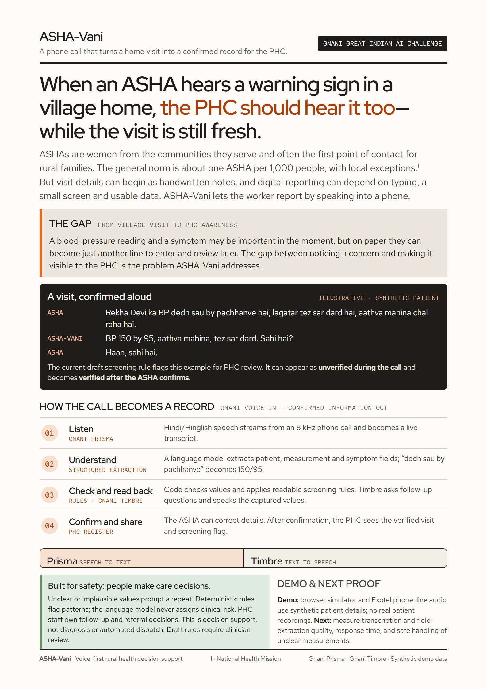

# ASHA-Vani (आशा-वाणी)

**Voice-to-Register Decision Support & Early Warning System for Rural Maternal Healthcare**  
*Built for the Gnani AI Great Indian AI Internship Challenge*

📄 **[View / Download One-Page Solution Pitch (A4 PDF)](./ASHA-Vani_Solution_Pitch_A4.pdf)**



---

## 1. The Problem

India has nearly **one million ASHA (Accredited Social Health Activist) workers** conducting doorstep maternal health visits across rural villages. After visits, they spend hours copying vitals into paper registers, while digital government apps assume smartphones, reliable mobile data, and vernacular typing. Dangerous pregnancy signs—such as **severe hypertension with headache (pre-eclampsia risk), severe anemia, or antepartum bleeding**—can reach a Primary Health Centre (PHC) doctor days late.

## 2. What ASHA-Vani Does

With **ASHA-Vani**, an ASHA worker dials a toll-free number from any basic feature phone after a home visit and speaks naturally in **Hindi / Hinglish**:

1. **Telephone Audio Ingest:** Normalizes call audio to **8 kHz, 16-bit mono PCM** in **1024-byte (64 ms) frames** (300–3400 Hz telephone bandpass + G.711 $\mu$-law conditioning).
2. **Streaming Speech-to-Text (Gnani Prisma):** Transcribes rural Hindi/Hinglish speech in real time, detecting turn completion via natural pause (~1.2s) or a spoken `"over"` trigger.
3. **Structured LLM Extraction (Groq Llama 3.3 70B / 8B fallback):** Extracts structured candidate fields (`gestational_weeks`, `bp_systolic`, `bp_diastolic`, `hb_g_dl`, `symptoms`, and patient details).
4. **Hard/Soft Clinical Validation:** Rejects implausible or corrupted numbers (`ERROR` values are cleared and routed to a repeat prompt—never stored).
5. **Deterministic Rule Engine (`R1–R8`):** Evaluates sanitized vitals and danger signs to assign `ROUTINE`, `URGENT`, or `CRITICAL` screening levels with explicit rule IDs. **The LLM never assigns clinical risk.**
6. **Digit-by-Digit Spoken Confirm-Back (Gnani Timbre TTS):** Reads captured values back to the ASHA worker under strict half-duplex speaker control. Records start as `UNVERIFIED` and flip to `VERIFIED` only after confirmation.
7. **Live PHC Register & Pipeline Inspector Console:** Updates the Primary Health Centre's register table after each turn, sorted by triage priority (`CRITICAL` → `URGENT` → `ROUTINE`), with a slide-over **Step-by-Step Pipeline Inspector** showing what Prisma heard, what the LLM extracted, validation checks, rule engine decisions, and stage latencies.

> **Safety Boundary:** ASHA-Vani is clinical decision support and early warning—**not** an autonomous doctor or diagnosis engine, and **not** an automatic ambulance dispatcher. A human at the PHC owns every final referral action. All demo telephony and alerts use **100% synthetic data** and are explicitly labeled **`SIM`**.

---

## 3. Repository Structure

```text
ASHA-Vani/
├── AGENTS.md                        # System map, module ownership & edge-case invariants
├── ASHA-Vani_Solution_Pitch_A4.pdf  # One-page A4 Solution Pitch (PDF)
├── ASHA-Vani_Solution_Pitch.png     # One-page A4 Solution Pitch (High-Res Preview)
├── SOLUTION_PITCH.md                # Full narrative solution pitch
├── docs/
│   ├── exotel-setup.md              # Exotel AgentStream PSTN setup guide
│   ├── furrow-design.md             # Furrow field-records design system spec
│   ├── solution_pitch.html          # Printable HTML one-page pitch
│   └── solution_pitch.tex           # LaTeX source for one-page pitch
├── src/asha_vani/
│   ├── __init__.py
│   ├── extraction.py                # Groq Llama 3.3 extraction, Roman transliteration & fallback
│   ├── schemas.py                   # Pydantic models (ExtractedVisit, ValidationResult, TriageResult)
│   ├── validation.py                # Hard/soft clinical range & BP consistency checks
│   ├── triage.py                    # Deterministic maternal danger-sign rule engine (R1–R8)
│   ├── graph.py                     # LangGraph per-turn state machine (call_graph)
│   ├── persistence.py               # Supabase + local disk cache persistence
│   ├── server.py                    # FastAPI + WebSocket server (/simulator, /ws/call, /ws/console)
│   └── voice/                       # Audio conditioning, Gnani Prisma/Timbre, CallSession, simulator_furrow.html
└── tests/
    ├── test_exotel_protocol.py      # Exotel AgentStream media & auth unit tests
    ├── test_extraction.py           # Hindi/Hinglish/Devanagari extraction unit tests
    ├── test_graph_flow.py           # Multi-turn LangGraph confirmation & correction flow tests
    ├── test_persistence.py          # Supabase persistence & history matching tests
    ├── test_validation.py           # Boundary & consistency unit tests
    ├── test_triage.py               # Rule engine R1–R8 unit tests
    └── test_voice.py                # Voice pipeline, CallSession & TurnRunner unit tests
```

---

## 4. Quick Start

### Prerequisites
- Python **3.13+**
- [`uv`](https://docs.astral.sh/uv/) package manager

### 1. Install Dependencies & Run Tests
```bash
uv sync
uv run pytest
```

### 2. Configure live model and database services

Copy `.env.example` to `.env` and add the Gnani and Groq API keys. To enable
database persistence, also set `SUPABASE_URL` and `SUPABASE_SERVICE_ROLE_KEY`.
The service-role key is backend-only; do not put it in browser code or commit
`.env`.

Apply `supabase/migrations/202611100001_initial_demo_persistence.sql` to the
Supabase project (SQL Editor or Supabase CLI). Without database credentials,
the call flow still runs but `/api/register` reports persistence as disabled.

### 3. Run the Live Voice Server & 75/25 Nokia Simulator Workspace
```bash
uv run asha-vani
```
Then open **`http://127.0.0.1:8000/simulator`** (or open [`src/asha_vani/voice/simulator.html`](src/asha_vani/voice/simulator.html) directly in your browser):
- **Left 75%:** PHC Rampur Register table (priority sorting, village/triage filters, 1-click referral status pill, and the **Slide-Over Step-by-Step Turn Pipeline Inspector**).
- **Right 25%:** Classic **Nokia feature-phone simulator** with live laptop mic capture, village noise selector (`Clean / 10 dB / 5 dB SNR`), and 1-click synthetic call scenarios.

---

## 5. Team & Work Split

| Teammate | Focus Area | Key Modules |
|---|---|---|
| **Person A** | Voice transport, audio conditioning, Gnani Prisma/Timbre, `CallSession`, Nokia Simulator & Eval harness | `src/asha_vani/voice/`, `src/asha_vani/server.py`, `tests/test_voice.py` |
| **Person B** | Clinical schemas, validation, deterministic triage rules (`R1–R8`), LangGraph flow, LLM extraction & DB persistence | `src/asha_vani/schemas.py`, `validation.py`, `triage.py`, `graph.py` |

---

## 6. Future Prospects

- **Pan-India Multilingual Expansion (All Indian Languages):** ASHA workers serve rural communities across every state and union territory in India. Because our clinical validation (`validation.py`) and deterministic triage rule engine (`R1–R8` in `triage.py`) operate on language-agnostic structured schemas, we plan to expand ASHA-Vani across **all major Indian languages**—including **Tamil, Telugu, Kannada, Malayalam, Marathi, Bengali, Gujarati, Odia, Punjabi, and Assamese**—by switching **Gnani Vachana Prisma STT** and **Gnani Timbre TTS** language codes (`ta-IN`, `te-IN`, `kn-IN`, `ml-IN`, `mr-IN`, `bn-IN`, `gu-IN`, `pa-IN`) per caller profile or state toll-free number, while continuing to normalize all PHC register entries into standardized English for Medical Officers.
- **Automatic Language Detection & Worker Routing:** Link each ASHA worker's registered 3-digit ID / caller phone number to her preferred regional language and localized readback prompts automatically on call connect.
- **Expanded NHM / RCH Register Coverage:** Extend deterministic rule sets beyond maternal ANC/PNC screening to cover neonatal danger signs (HBNC), childhood immunization tracking, and tuberculosis/anemia follow-ups.
- **Two-Way SMS Receipt for Feature Phones:** Send an automatic SMS confirmation in the ASHA worker's local script immediately after a visit is marked `VERIFIED` so she has a portable receipt on her basic handset.


