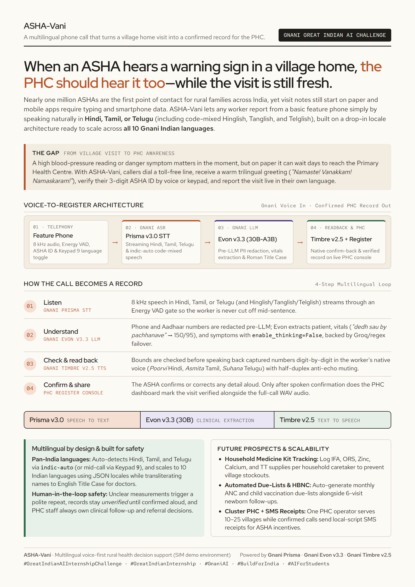
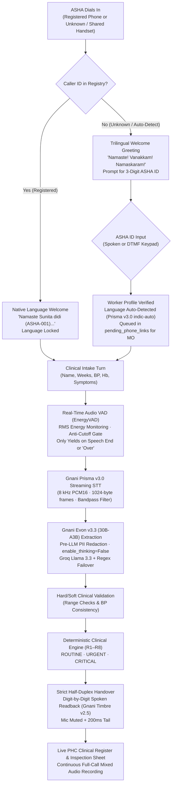

# ASHA-Vani

**Multilingual Voice-to-Register Decision Support & Early-Warning System for Rural Healthcare**  
*Built with **Gnani.ai** (`Prisma v3.0 STT` · `Evon v3.3` · `Timbre v2.5 TTS`) for the **Great Indian AI Internship Challenge***

📄 **[View / Download One-Page Solution Pitch (A4 PDF)](./ASHA-Vani_Solution_Pitch_A4.pdf)** · 📖 **[Read Full Pitch Summary](./SOLUTION_PITCH.md)**



---

## 1. The Problem & Why Voice Matters

Nearly **one million ASHA workers** are the first point of contact for maternal and rural family healthcare across Indian villages. Yet visit notes still start in handwritten paper registers and are batch-digitized days or weeks later, while mobile health apps assume smartphone ownership, usable cellular data, and vernacular typing fluency. When an ASHA detects a maternal warning sign or abnormal vital during a doorstep visit, the Primary Health Centre (PHC) Medical Officer should know while the visit is still fresh.

**ASHA-Vani** turns any basic **2G feature phone** into a zero-typing, voice-verified clinical register and early-warning pipeline. An ASHA worker dials in from the field and speaks naturally in **Hindi, Tamil, or Telugu** (including code-mixed **Hinglish, Tanglish, and Telglish**), or uses keypad DTMF digits. Throughout the call, the system enforces a single clinical safeguard: **the LLM extracts; deterministic code decides.**

---

## 2. Powered by the Gnani.ai Stack

| Gnani Model | Role in ASHA-Vani | How It Works |
|---|---|---|
| **Gnani Prisma v3.0 STT** | Real-Time Multilingual ASR | Streams 8 kHz telephony audio (`1024`-byte / `64 ms` frames) with `indic-auto` language identification across **Hindi (`hi-IN`)**, **Tamil (`ta-IN`)**, and **Telugu (`te-IN`)**, preserving mixed rural dialects. |
| **Gnani Evon v3.3 (`30B-A3B`)** | Structured Clinical Extraction | Parses spoken speech (e.g., *"dedh sau by pachhanave"* → `150/95`) with `enable_thinking=False` for low-latency turns after pre-LLM PII redaction (phones & Aadhaar), normalizing names and villages into **English Title Case** with automatic Groq & regex failover. |
| **Gnani Timbre v2.5 TTS** | Native Confirm-Back Readback | Speaks captured vitals back digit-by-digit in the worker's own language (`Poorvi` Hindi, `Asmita` Tamil, `Suhana` Telugu) using cached fixed prompts and an anti-echo half-duplex speaker gate. |

---

## 3. How a Call Becomes a Verified PHC Record



1. **Multilingual Auto-Detect & Code-Mixed Speech (`Hindi`, `Tamil`, `Telugu` + Keypad `9`):** Unknown or shared phones receive a warm trilingual greeting (*"Namaste! Vanakkam! Namaskaram!"*), resolve the caller's active language automatically via `indic-auto`, handle **Hinglish / Tanglish / Telglish** seamlessly, and allow mid-call language switching anytime via **Keypad `9`**.
2. **ASHA Worker ID & Shared-Phone Verification:** Registered callers are greeted by name from Supabase (`asha_workers` / `asha_worker_phones`), while unrecognized handsets authenticate with a spoken or keypad **3-digit ASHA ID** and queue new numbers in `pending_phone_links` for PHC Medical Officer approval.
3. **Energy-Based VAD & Half-Duplex Anti-Echo Audio:** Real-time RMS energy monitoring (`EnergyVAD`) ensures speakers are never cut off mid-sentence; TTS playback locks the incoming mic plus a **200 ms acoustic tail guard**, while saving an uncompressed **8 kHz WAV recording** of the entire call for PHC audit playback.
4. **Human-in-the-Loop Clinical Safety (`UNVERIFIED` -> `VERIFIED`):** Impossible readings fail hard validation and prompt a targeted spoken repeat rather than guessing. High-risk visits appear immediately on the PHC Register marked `UNVERIFIED (In Call)` and flip to `VERIFIED` only after the worker confirms the spoken readback aloud.

---

## 4. Future Prospects & Rural Scalability

📘 **[Read the Full Future Roadmap & Village Deployment Spec (docs/FUTURE_ROADMAP_AND_SCALING.md)](./docs/FUTURE_ROADMAP_AND_SCALING.md)**

- **Expansion to All 10 Gnani Indian Languages:** Drop-in JSON locale files (`src/asha_vani/language/locales/`) allow Hindi, Tamil, and Telugu support to expand cleanly across Kannada, Malayalam, Marathi, Bengali, Gujarati, and Punjabi without touching core clinical code.
- **Whole-Village Household & Medicine Kit Tracking:** Branch voice intake across household demographics and track doorstep supplies (IFA iron tablets, ORS packets, Zinc, Calcium, and TT injections) linked to the household caretaker, triggering automated PHC pharmacy restock alerts.
- **Automated Monthly Due-Lists & Home-Based Newborn Care (HBNC):** Auto-compile upcoming monthly ANC checkup and child vaccination due-lists while extending screening workflows to 6-visit neonatal danger signs.
- **Cluster PHC Deployment & Two-Way SMS Receipts:** Centralize monitoring so one PHC console serves 10–25 villages (20,000–30,000 rural residents), while every confirmed call triggers an automatic local-script SMS receipt for ASHA performance-linked incentives.

---

## 5. Quick Start

### Prerequisites
- Python **3.13+**
- [`uv`](https://docs.astral.sh/uv/) package manager

### 1. Install Dependencies & Run Tests
```bash
uv sync
uv run pytest
```
*Verified test suite: **100 passing tests**.*

### 2. Configure Model & Database Services

Copy `.env.example` to `.env` and fill in your credentials (see [docs/evon-kaggle-setup.md](./docs/evon-kaggle-setup.md) to host **Gnani Evon v3.3** on free Kaggle `2× T4` GPUs):
```env
# Gnani Speech APIs
GNANI_API_KEY=your_gnani_vachana_api_key

# Gnani Evon v3.3 LLM Extraction (Primary OpenAI-compatible /v1 endpoint)
EVON_BASE_URL=
EVON_API_KEY=EMPTY
EVON_MODEL=gnani/gnani-evon-v3.3-30B-A3B
EVON_TIMEOUT_S=8.0

# Groq LLM Extraction (Automatic Fallback)
GROQ_API_KEY=your_groq_api_key
GROQ_MODEL=llama-3.3-70b-versatile
GROQ_FALLBACK_MODEL=llama-3.1-8b-instant

# Supabase Persistence (Optional - falls back to local JSON cache)
SUPABASE_URL=https://your-project.supabase.co
SUPABASE_SERVICE_ROLE_KEY=your_service_role_key
```

Seed the Pan-India ASHA worker phone registry (runs with `data/asha_workers.json` offline if Supabase isn't set):
```bash
uv run python scripts/seed_asha_workers.py
```

### 3. Launch the Live Voice Server & Workspace
```bash
uv run asha-vani
```
Open **`http://127.0.0.1:8000/simulator/furrow`**:
- **Left 75% — PHC Clinical Register:** Priority-sorted triage feed, village filters, 1-click referral action slips, and a slide-over turn inspector with full-call WAV playback.
- **Right 25% — Nokia Feature Phone Simulator:** Quick language chips (`🌐 Auto`, `हिन्दी`, `தமிழ்`, `తెలుగు`), real-time mic capture with VAD meter (`Mic: [▮▮▮·] XX%`), rural line noise modes (`Clean`, `15 dB`, `5 dB SNR`), and a live DTMF keypad (`9` switches language, `#` sends turns).

---

## 6. Repository Structure

```text
ASHA-Vani/
├── AGENTS.md                        # System map, module ownership & edge-case invariants
├── ASHA-Vani_Solution_Pitch_A4.pdf  # One-page A4 Solution Pitch (PDF)
├── ASHA-Vani_Solution_Pitch.png     # One-page A4 Solution Pitch (PNG preview)
├── SOLUTION_PITCH.md                # Concise solution pitch summary
├── data/
│   └── asha_workers.json            # Seeded Pan-India ASHA worker & phone routing registry
├── docs/
│   ├── FUTURE_ROADMAP_AND_SCALING.md # Full Pan-India & village deployment scaling spec
│   ├── evon-kaggle-setup.md         # Free Kaggle 2x T4 hosting runbook for Gnani Evon v3.3
│   ├── exotel-setup.md              # Exotel AgentStream PSTN setup guide
│   ├── furrow-design.md             # Furrow field-records design system spec
│   ├── locale_review_sheet.md       # Native-speaker review sheet for HI/TA/TE prompts
│   ├── solution_pitch.html          # Printable HTML one-page pitch
│   └── solution_pitch.tex           # LaTeX source for one-page pitch
├── scripts/
│   └── seed_asha_workers.py         # Upsert ASHA worker profiles & phone links into Supabase
├── src/asha_vani/
│   ├── __init__.py
│   ├── extraction.py                # Gnani Evon v3.3 + Groq/regex failover, PII redaction & transliteration
│   ├── schemas.py                   # Pydantic models (ExtractedVisit, ValidationResult, TriageResult)
│   ├── validation.py                # Hard/soft clinical range & BP consistency checks
│   ├── triage.py                    # Deterministic maternal danger-sign rule engine (R1–R8)
│   ├── graph.py                     # LangGraph per-turn state machine (call_graph)
│   ├── persistence.py               # Supabase + local disk cache persistence
│   ├── server.py                    # FastAPI + WebSocket server (/simulator, /furrow, /ws/call, /ws/console)
│   ├── language/                    # Pan-India locale registry, caller-ID routing & HI/TA/TE JSONs
│   └── voice/                       # Audio conditioning, EnergyVAD, Gnani Prisma/Timbre, CallSession
└── tests/                           # 100 unit & integration tests (validation, triage, voice, Exotel, locales)
```

---

## Powered by Gnani.ai

Built with **Gnani Prisma v3.0 STT**, **Gnani Evon v3.3 (`30B-A3B`) LLM**, and **Gnani Timbre v2.5 TTS** for the **Gnani.ai Great Indian AI Internship Challenge**.

`#GreatIndianAIInternshipChallenge` `#GreatIndianInternship` `#GnaniAI` `#BuildForIndia` `#AIForStudents` `#VoiceAI` `#SovereignAI`
