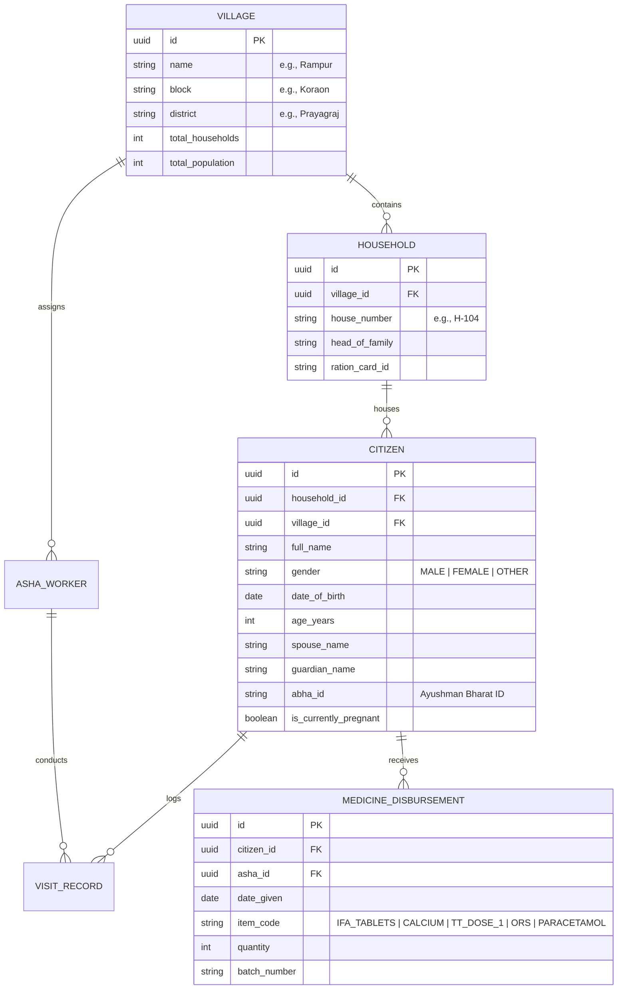
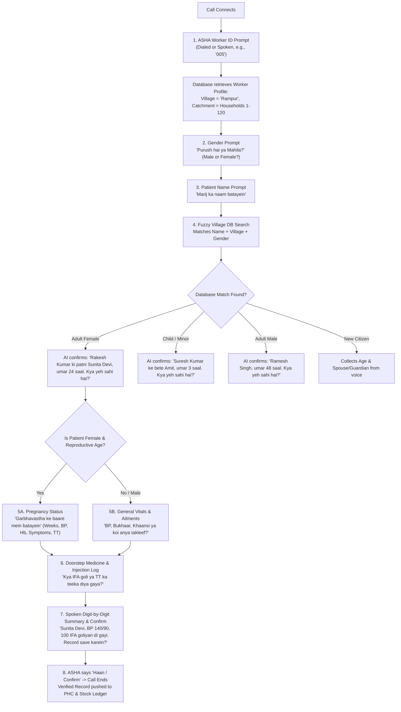

# ASHA-Vani 2.0: Future Roadmap, Scaling & Village Deployment Spec

> **Document Purpose:** Strategic architectural blueprint for expanding ASHA-Vani beyond maternal screening into a **universal village household health register, medicine supply logger, and rural healthcare scaling pipeline**.

---

## 1. Executive Summary & Vision 2.0

ASHA-Vani 1.0 proved that basic feature phones can power deterministic clinical decision support and maternal early warnings with zero typed input. **ASHA-Vani 2.0** scales this architecture to cover the **entire village health lifecycle**:
- **Household-Level Census & Identity Resolution:** Automatically maps each ASHA worker to her assigned village and household database.
- **Dynamic Branching Intake:** Tailors conversational flows based on patient gender, age, and pregnancy status (e.g., proactive spouse lookup, guardian confirmation for pediatric patients).
- **Doorstep Medicine & First Aid Logging:** Tracks Tetanus Toxoid (TT) vaccinations, IFA (Iron-Folic Acid) distribution, and first-aid kits at the doorstep.
- **Institutional Healthcare Integration:** Directly escalates critical red flags to Government Medical Officers (PHC/CHC doctors) and tracks pharmacy replenishment.

---

## 2. Village Implementation & Healthcare Infrastructure Scaling

### 2.1 Rural Administrative Hierarchy

To understand where to deploy hardware and personnel, we map to the **National Health Mission (NHM)** structural framework:

| Healthcare Tier | Catchment Population | Villages Covered | Key Personnel | ASHA-Vani Role |
|---|---|---|---|---|
| **Village / Doorstep** | ~1,000 | 1 Village | 1 ASHA Worker | Voice feature-phone caller (audio intake) |
| **Sub-Centre (Health & Wellness Centre / AAM)** | 3,000 – 5,000 | 3 – 5 Villages | 1 ANM (Auxiliary Nurse Midwife), 1 CHO (Community Health Officer) | Field tablet view for routine follow-ups & TT vaccination drives |
| **Primary Health Centre (PHC)** | 20,000 – 30,000 | **10 – 25 Villages** | 1–2 Medical Officers (MBBS), 1 Pharmacist, 1 Staff Nurse | **Primary ASHA-Vani Console Station**: Medical Officer triage, dispatch & drug inventory |
| **Community Health Centre (CHC) / First Referral Unit (FRU)** | 80,000 – 120,000 | 80 – 120 Villages | Specialists (Obs/Gyn, Pediatrician, Surgeon) | Emergency 108 ambulance receiver for critical eclampsia & hemorrhage |

---

### 2.2 Deployment & Staffing Recommendation: Where to Station PHC Console Workers

> **Core Recommendation: Station 1 ASHA-Vani Console Station per Primary Health Centre (PHC) covering 10–25 villages (~15–30 ASHA workers).**

#### Why NOT Station Operators in Every Single Village?
- Rural Sub-Centres lack dedicated IT clerks, stable fiber broadband, and continuous air-conditioned desktop facilities.
- Having a dedicated computer operator in every single village of 1,000 people is fiscally wasteful and operationally unsustainable.

#### The 1-per-10-to-20 Villages Model (Sector PHC Station):
1. **Stationed at the PHC:** A trained Data Entry Operator / Senior ANM Supervisor sits at the PHC monitoring the **ASHA-Vani Fieldbook Console** on a desktop PC.
2. **Real-Time Automated Escalation to Doctors:** When a call triggers `CRITICAL` (e.g. Rule R1: BP 160/110 with headache), the system does not wait for manual clerk entry—it sends an instant **automated SMS/WhatsApp emergency telemetry alert** to the PHC Medical Officer on duty with the exact patient name, village, vitals, and one-click dispatch button.
3. **Sub-Centre ANM Sync:** Local ANMs receive a daily mobile digest of visits logged in their 3–5 village sub-catchment to coordinate doorstep injections and medicine delivery.

---

## 3. Village Demographic & Household Database Architecture

In Version 2.0, calls are contextualized by a pre-seeded **Village Citizen Database** (integrated with existing Census, Ration Card, or Ayushman Bharat ABHA registries):



---

## 4. The Unified Conversational Flow (Version 2.0)

Instead of only handling maternal visits, the conversation dynamically retrieves village records and branches based on gender and age:



---

## 5. Doorstep Medicine Logging & First Aid Tracking

ASHA workers are the frontline dispensary for essential primary kits. Version 2.0 incorporates structured inventory logging directly into the voice turn:

### 5.1 Tracked Items & Protocols

| Category | Item Name | Voice Keyword Triggers | Standard Dosage / Unit | Clinical Purpose |
|---|---|---|---|---|
| **Maternal Injections** | Tetanus Toxoid (TT-1 / TT-2 / TT Booster) | `TT ka teeka`, `tetanus dose`, `injection diya` | 0.5 mL IM | Maternal & neonatal tetanus prevention |
| **Nutritional Supplements** | Iron-Folic Acid (IFA) Red Tablets | `IFA goliyan`, `iron ki goli`, `laal goli` | 100 or 180 Tablets | Prevention of maternal anemia |
| **Bone Health** | Calcium & Vitamin D3 Tablets | `Calcium ki goli`, `safed goli` | 360 Tablets (from 14 weeks) | Prevention of gestational pre-eclampsia & bone depletion |
| **Child De-worming** | Albendazole (400 mg) | `Kide ki dawai`, `albendazole` | 1 Chewable Tablet | Semi-annual deworming |
| **Pediatric First Aid** | Oral Rehydration Salts (ORS) + Zinc | `ORS packet`, `jeewan amrit`, `dast ki dawai` | 2 Packets ORS + 14 Zinc tabs | Dehydration in acute childhood diarrhea |
| **General First Aid** | Paracetamol (500mg) & Povidone Iodine | `Bukhaar ki goli`, `chot ki dawai`, `bandage` | Strips / 10 mL Ointment | Village trauma, fever, and post-vaccination fever |

### 5.2 Automatic Pharmacist Re-Stocking Alert
When an ASHA reports dispensing:
- The system decrements her active kit inventory balance in the PHC pharmacy ledger.
- When her IFA count drops below 200 tablets or TT vials are exhausted, an automated notification appears on the PHC Pharmacist's morning dispatch sheet:
  > *"ASHA-001 (Sunita Devi, Rampur) requires 400 IFA tablets and 10 TT ampoules for upcoming Wednesday Immunization Day (VHSND)."*

---

## 6. Doctor Reporting & Government Tele-Triage Loop

### 6.1 Daily Medical Officer Morning Briefing (Automated WhatsApp & Web Digest)
At 08:30 AM every morning, the PHC Medical Officer receives an automated, priority-sorted clinical PDF & WhatsApp briefing:
- **Red Alert (Critical Immediate):** Patients with pre-eclampsia indicators (BP ≥ 160/110 mmHg), severe anemia (<7.0 g/dL), or reduced fetal movement.
- **Yellow Alert (Urgent 24h Review):** Moderate hypertension (140–159 / 90–99 mmHg) or unattended high fevers.
- **Green List (Routine):** Normal ANC progress and routine immunization visits.

### 6.2 1-Click Referral Slip Generation
The system generates a standard **NHM Form 4A Referral Slip** printable directly from the PHC console or sendable to 108 Emergency Ambulance Dispatch:
```text
===================================================================
ASHA-VANI EMERGENCY CLINICAL REFERRAL SLIP (SIMULATED NHM FORM 4A)
PHC RAMPUR · SECTOR KORAON · DISTRICT PRAYAGRAJ
===================================================================
Patient:       Sunita Devi (W/o Rakesh Kumar)
Age / Sex:     24 Yrs / Female
Village:       Rampur (House H-104) | ASHA Worker: Sunita Kumari (ASHA-001)
Vitals:        Gestational 32w | BP 162/112 mmHg | Hb 6.4 g/dL
Danger Signs:  Severe Continuous Headache, Blurred Vision, Facial Swelling
Clinical Flag: R1_SEVERE_HYPERTENSION, R2_PREECLAMPSIA_SIGNS, R5_SEVERE_ANEMIA
Risk Status:   CRITICAL (VERIFIED VIA TIMBRE TTS CONFIRMATION)
Medicines:     100 IFA dispensed, TT Booster administered on 12-Nov-2026
Recommended:   IMMEDIATE TRANSFER TO FIRST REFERRAL UNIT (FRU) / CHC.
               Administer Loading Dose Magnesium Sulphate under MO supervision.
===================================================================
```

---

## 7. Code Implementation Guide: Where to Make Changes in Future Versions

To evolve this repository cleanly from 1.0 to 2.0 without architectural debt, update the modules in the exact sequence below:

```text
src/asha_vani/
├── schemas.py           <-- Step 1: Add Household, Citizen, MedicineDisbursement & Gender models
├── language/locales/    <-- Step 2: Add prompts for Gender, Spouse/Guardian, and Medicine intake
├── validation.py        <-- Step 3: Add ranges for pediatric vitals & medicine quantities
├── triage.py            <-- Step 4: Add Rule R9-R14 (Childhood SAM, Adult Hypertensive Crisis, TT gaps)
├── extraction.py        <-- Step 5: Update Groq prompt with Citizen & Medicine extraction schema
├── graph.py             <-- Step 6: Expand LangGraph state machine with demographic & medicine nodes
├── persistence.py       <-- Step 7: Add Supabase tables for households, citizens & medicine logs
└── server.py            <-- Step 8: Update console feeds & pharmacist inventory endpoints
```

### Exact Code Modifications Required

#### Step 1: `src/asha_vani/schemas.py`
- Add `PatientGender = Literal["MALE", "FEMALE", "OTHER"]`
- Add `MedicineDisbursement(item_code: str, quantity: int, dose_number: int | None)`
- Expand `ExtractedVisit` to include `gender`, `spouse_or_guardian_name`, `household_number`, `medicines_given: list[MedicineDisbursement]`.

#### Step 2: `src/asha_vani/language/locales/hi.json`, `ta.json`, `te.json`
- Add prompt keys:
  - `"ask_gender"`: `"Marij mahila hain ya purush?"` (Is the patient female or male?)
  - `"ask_medicines"`: `"Kya koi goli ya injection diya gaya?"` (Were any tablets or injections given?)
  - `"confirm_citizen"`: `"{guardian_or_spouse} ke {relation} {name}, umar {age} saal. Kya yeh sahi hai?"`

#### Step 3: `src/asha_vani/graph.py` (LangGraph State Machine)
- Insert conditional routing nodes after `extract`:
  - `route_demographics`: If patient is unknown in village DB, ask gender and name.
  - `lookup_village_db`: Query Supabase `citizens` by village + name soundex.
  - `route_clinical_track`: If `gender == "FEMALE"` and `age >= 15 and age <= 49`, prompt pregnancy questions (`ASK_PREGNANCY`); if male or child, jump to `ASK_SYMPTOMS` and `ASK_MEDICINES`.

#### Step 4: `src/asha_vani/triage.py` (Rule Engine Expansion)
- Add deterministic rules:
  - `R9_TT_VACCINATION_OVERDUE`: Pregnant woman > 28 weeks with 0 doses of TT recorded.
  - `R10_PEDIATRIC_ACUTE_DIARRHEA`: Child < 5y with diarrhea lacking ORS/Zinc therapy.
  - `R11_ADULT_HYPERTENSIVE_URGENCY`: Non-pregnant adult with systolic BP ≥ 180 mmHg or diastolic ≥ 110 mmHg.

#### Step 5: `supabase/migrations/`
- Add migration `202611200001_village_household_schema.sql` creating `villages`, `households`, `citizens`, `medicine_inventory`, and `medicine_logs` with row-level security.

---

## 8. Summary: Why This Model Wins in the Real World

1. **No Hardware Burden on the Village:** The ASHA uses whatever feature phone she already carries. No batteries to charge, no touchscreens to crack, and no 4G signal required.
2. **Sub-Centre & PHC Harmony:** Keeps clerks and Medical Officers at the cluster PHC (10–20 villages) where infrastructure and electricity exist, while empowering ASHAs to feed data directly from mud huts and doorstep verandas.
3. **Audit-Ready & Fraud-Resistant:** Every medicine disbursed and danger sign escalated is backed by an **uncompressed 8 kHz audio recording** in the caller's own voice, providing an undeniable medical-legal trail for the district health department.

